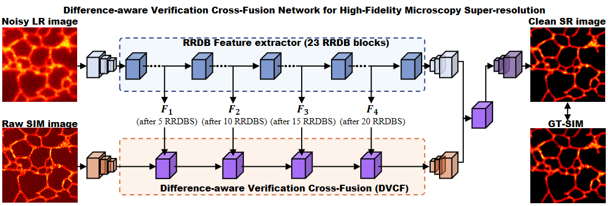
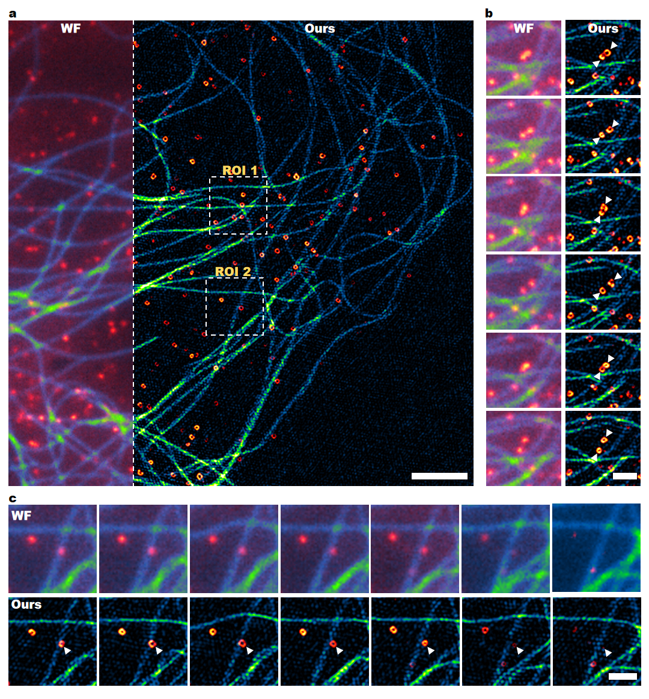

# DVCF-Net: Difference-aware Verification Cross Fusion for Microscopy Image Reconstruction




DVCF-Net is a dual-input microscopy reconstruction network that combines a low-resolution wide-field (WF) image with a corresponding structured illumination microscopy (SIM) reconstruction. It aims to preserve reliable structures observed in WF imaging while selectively incorporating high-frequency SIM information and suppressing inconsistent or potentially artifactual details.





This repository contains a standalone PyTorch implementation for training and inference, pretrained weights for the microtubule examples, and two paired WF/SIM test images.

> **Repository scope:** The original training dataset is not distributed with this repository. The files under `testdata/` are inference examples and do not include independent ground truth.

## Highlights

- Dual-input reconstruction from WF and SIM images.
- Difference-aware comparison using absolute feature differences and element-wise products.
- Four explicit paths for common, WF-specific, SIM-specific, and conflicting information.
- Multi-level fusion using the 5th, 10th, 15th, and 20th WF RRDB features.
- Final high-resolution fusion after both branches have been upsampled.
- Joint pixel, perceptual, and relativistic adversarial training objectives.
- End-to-end processing of single-channel microscopy images.

## Repository Structure

```text
DVCF_clean/
|-- data/
|-- models/
|   `-- modules/
|       |-- architecture.py
|       |-- block.py
|       |-- dvcf_architecture.py
|       `-- loss.py
|-- options/
|   |-- train/train_dvcf.json
|   `-- test/test_dvcf.json
|-- testdata/
|   |-- WF/
|   `-- SIM/
|-- weights/
|   `-- MTs.pth
|-- utils/
|-- train.py
|-- test.py
|-- requirements.txt
`-- README.md
```

## Requirements

- Python 3.8 or later
- PyTorch and torchvision
- NumPy
- OpenCV
- LMDB
- A CUDA-capable GPU is recommended

Create and activate a virtual environment:

```bash
python -m venv .venv
```

Linux or macOS:

```bash
source .venv/bin/activate
pip install -r requirements.txt
```

Windows PowerShell:

```powershell
.venv\Scripts\Activate.ps1
pip install -r requirements.txt
```

For GPU execution, install a PyTorch build compatible with your CUDA environment before installing the remaining packages. Dependency versions are currently not pinned; record the Python, PyTorch, torchvision, CUDA, and cuDNN versions when reproducing experiments.

## Quick Inference

The default configuration points to the included microtubule examples and pretrained generator:

```bash
python test.py -opt options/test/test_dvcf.json
```

The relevant paths are:

```json
{
  "dataroot_LR": "testdata/WF",
  "dataroot_SIM": "testdata/SIM",
  "pretrain_model_G": "weights/MTs.pth"
}
```

Reconstructed TIFF images are written to:

```text
results/DVCF_test/MTs_test/
```

## Preparing a Training Dataset

Organize WF, SIM, and ground-truth images in separate directories:

```text
datasets/
|-- train/
|   `-- CCPs/
|       |-- WF/
|       |-- SIM/
|       `-- GT/
`-- test/
    `-- CCPs/
        |-- WF/
        |-- SIM/
        `-- GT/
```

For example:

```text
datasets/train/CCPs/WF/0001.tif
datasets/train/CCPs/SIM/0001.tif
datasets/train/CCPs/GT/0001.tif
```

Images are paired by sorted filename order. Ensure all three directories contain the same number of files and use a consistent naming convention.

Default training crops:

| Image | Patch size |
|---|---:|
| WF | `128x128` |
| SIM | `256x256` when SIM matches the GT resolution |
| Ground truth | `256x256` |

The loader converts grayscale images to single-channel floating-point tensors in `[0, 1]`. Augmentation includes random horizontal flips, vertical flips, and 90-degree rotations.

## Training

Update the dataset paths in [`options/train/train_dvcf.json`](options/train/train_dvcf.json), then run:

```bash
python train.py -opt options/train/train_dvcf.json
```

Training outputs are saved under:

```text
experiments/DVCF_train/
|-- models/
|-- training_state/
|-- val_images/
`-- train_*.log
```

To resume training, set `resume_state` in the training JSON. Generator and discriminator checkpoints can also be initialized separately through `pretrain_model_G` and `pretrain_model_D`.

The first run may require torchvision to download the ImageNet-pretrained VGG-19 weights. The implementation uses FP32 training and does not currently enable automatic mixed precision.

## Evaluation Notes

The example configuration uses `testdata/SIM` for both the SIM input and the nominal HR path because independent ground truth is not included. The examples are suitable for demonstrating inference and measuring runtime, but they must not be used to report independent PSNR or SSIM results.

For quantitative evaluation, prepare a separate test set with WF, SIM, and independent ground-truth images. Besides PSNR and SSIM, microscopy experiments may benefit from evaluating structural continuity, artifact suppression, and temporal consistency in live-cell sequences.
